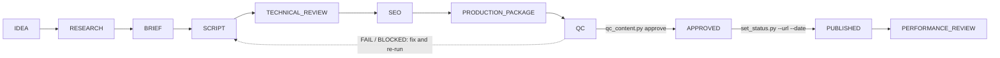

# Idea to publish: the master workflow

This is the end-to-end path of one Cartek video, long-form or Short. Every stage has entry criteria, work, outputs, exit criteria and the QC gates it feeds. Stage names, Vietnamese labels and sheet statuses come from [config/workflow.yaml](../config/workflow.yaml).

**Skills used:** all seven, in order. See the "Skill" line of each stage.

**Done when:** the item is `PUBLISHED` with a real URL and date, the sheet row is updated by hand, and `performance.yaml` holds real YouTube Studio data (`PERFORMANCE_REVIEW`).

## The flow



Plain-text version:

```text
IDEA -> RESEARCH -> BRIEF -> SCRIPT -> TECHNICAL_REVIEW -> SEO -> PRODUCTION_PACKAGE -> QC
     -> APPROVED (guarded: qc_content.py approve)
     -> PUBLISHED (guarded: set_status.py --url --date, approval still valid)
     -> PERFORMANCE_REVIEW (guarded: valid performance.yaml)
"On hold" is a flag on top of any stage, not a stage.
```

Moving backwards is allowed for every non-guarded stage. For example, a failed technical review can send the item back to `SCRIPT`.

## Stage commands

Every ordinary stage change goes through one command, which records history:

```bash
python3 scripts/set_status.py <ID> --stage <STAGE> --by "<your name>" --note "<why>"
```

Pause and resume work without losing the stage:

```bash
python3 scripts/set_status.py <ID> --hold "<reason, e.g. chờ xe thử>"
python3 scripts/set_status.py <ID> --resume
```

Check the item at any time. The automated gates never take the stage as evidence; they read the files.

```bash
python3 scripts/qc_content.py run <ID>
```

`scripts/validate_content.py` warns when the stage is past a step whose deliverable still has `[TODO]` markers.

## Stages

### 1. IDEA (Ý tưởng)

- **Entry:** a planning idea in [data/normalized/ideas.json](../data/normalized/ideas.json), or a new topic.
- **Work:** pick the idea, create the workspace, choose format, pillar and primary audience, assign an owner.
- **Skill:** [cartek-content-strategist](../skills/cartek-content-strategist/SKILL.md).
- **Outputs:** `content/<long-form|shorts>/<ID>-<slug>/` with `item.yaml`, `brief.md`, `research.md`, `script.md`, `seo.md`, `storyboard.md`. Fields: `working_title`, `format`, `pillar`, `video_type`, `audience.primary`, `owner`.
- **Exit:** topic, format, pillar and primary audience chosen; owner assigned.
- **Feeds:** G1.

```bash
python3 scripts/new_content.py --list-ideas --search "p0300"
python3 scripts/new_content.py --from-idea CTK-L-0015 --audience technician --owner "<name>"
```

A topic that is not in the sheet gets a new ID from the registry:

```bash
python3 scripts/new_content.py --format short --title "<tiêu đề>" --pillar S1 --audience car-owner
```

`new_content.py` never overwrites an existing workspace. A test item for trying the workflow uses `--test` and receives an ID from 9001 upward; it can never be approved or published.

### 2. RESEARCH (Nghiên cứu)

- **Entry:** the workspace exists.
- **Work:** answer the research question from traceable sources; register every technical statement as a claim. Follow [research.md](research.md).
- **Skill:** [automotive-researcher](../skills/automotive-researcher/SKILL.md).
- **Outputs:** `research.md`; `item.yaml` → `sources`, `claims` (status `unverified` until the technical review), `vehicle`, proposed `safety` flags.
- **Exit:** research.md complete; every technical claim registered with sources.
- **Feeds:** G3, and the G5 safety scan.

### 3. BRIEF (Brief nội dung)

- **Entry:** research findings exist.
- **Work:** fix audience, problem, takeaway, angle, scope and risks.
- **Skill:** [cartek-content-strategist](../skills/cartek-content-strategist/SKILL.md); persona and pillar guidance in [audience-personas.md](../strategy/audience-personas.md) and [content-pillars.md](../strategy/content-pillars.md).
- **Outputs:** `brief.md` (sections Audience, Problem, Takeaway, Angle, Scope, Risks); `item.yaml` → `problem`, `takeaway`, `search_intent`, `keywords`, `audience.technical_depth`.
- **Exit:** brief.md complete: audience, problem, takeaway, angle, scope, risks.
- **Feeds:** G1, G2.

### 4. SCRIPT (Kịch bản)

- **Entry:** brief complete.
- **Work:** hook candidates, selected hook, outline, segments with narration and visuals, CTA. Follow [script-production.md](script-production.md).
- **Skill:** [youtube-scriptwriter](../skills/youtube-scriptwriter/SKILL.md) for long-form; [shorts-content-specialist](../skills/shorts-content-specialist/SKILL.md) for Shorts.
- **Outputs:** `script.md`.
- **Exit:** script.md complete: hooks, outline, segments with VO + visuals, CTA.
- **Feeds:** G4, and G5 (public wording).

```bash
python3 scripts/qc_content.py runtime <ID>
```

### 5. TECHNICAL_REVIEW (Duyệt kỹ thuật)

- **Entry:** research and script have no `[TODO]` markers.
- **Work:** verify or remove every claim, decide safety flags and dismissals, record the review. Follow [technical-review.md](technical-review.md).
- **Skill:** [technical-fact-checker](../skills/technical-fact-checker/SKILL.md); a qualified human when any safety flag is set.
- **Outputs:** `item.yaml` → `claims[].status`, `verified_by`, `verified_on`, `safety`; `research.md` fact-check log; a `technical` review in `item.yaml` → `reviews`.
- **Exit:** all claims verified or removed; safety review recorded when flagged.
- **Feeds:** G3, G5.

### 6. SEO

- **Entry:** script and claims are stable.
- **Work:** intent, keyword evidence, titles, description, tags, chapters, thumbnails, related content, checklist. Follow [seo-optimization.md](seo-optimization.md).
- **Skill:** [youtube-seo-specialist](../skills/youtube-seo-specialist/SKILL.md).
- **Outputs:** `item.yaml` → `seo`; `seo.md`.
- **Exit:** SEO block in item.yaml complete; seo.md checklist complete.
- **Feeds:** G6, G8.

### 7. PRODUCTION_PACKAGE (Gói sản xuất)

- **Entry:** script, claims and SEO are final.
- **Work:** shot list with effects and text styles, sound and typography notes, assets, demo setup, owner and date, visibility plan; preview the handoff package. Visual rules: [strategy/visual-identity.md](../strategy/visual-identity.md) and the IDs in [config/visual-style.yaml](../config/visual-style.yaml).
- **Skill:** producer/editor (human), helped by [youtube-scriptwriter](../skills/youtube-scriptwriter/SKILL.md) for visuals.
- **Outputs:** `storyboard.md` (required for long-form): shot list with `Effects` and `Text style` columns, "Sound and effects" and "Typography" sections; `item.yaml` → `production.assets_required`, `production.demo_setup`, `production.footage_links`, `target_publish_date`, `publication.visibility_plan`.
- **Exit:** storyboard/shot list (with effects and text styles) and assets ready; draft export validates. G7 warns, without failing, on effect or role IDs missing from the library and on a `SAFETY:` segment with no `safety-banner` shot.
- **Feeds:** G7, G8.

```bash
python3 scripts/export_package.py <ID> --draft
```

The draft is written to `exports/production-package.draft.json` with `package_status: DRAFT_NOT_APPROVED` and its blocking issues. It must not be used for production. Its `visual_style` section lists the fonts, typography roles and effects the storyboard uses, with their library descriptions and the caption rules.

### 8. QC (Kiểm duyệt chất lượng)

- **Entry:** every deliverable is finished.
- **Work:** run the automated gates, then the independent judgment reviews, then the human editorial sign-off.
- **Skill:** [content-qc-inspector](../skills/content-qc-inspector/SKILL.md); approving editor (human).
- **Outputs:** `qc-report.md`; reviews in `item.yaml` → `reviews`.
- **Exit:** automated gates G1-G8 PASS and independent reviews recorded.
- **Feeds:** all gates and the approval decision.

```bash
python3 scripts/qc_content.py run <ID> --record
python3 scripts/qc_content.py review <ID> --file <review.yaml>
python3 scripts/qc_content.py status <ID>
```

Approval needs all of these on the **current content fingerprint** ([config/qc-policy.yaml](../config/qc-policy.yaml) → `approval`):

1. Automated gates G1-G8 all PASS.
2. The item is not a test item.
3. A `qc` review with PASS for G2, G4, G6 and G7 (agent or human).
4. A `technical` review with PASS for G3 and G5 (agent or human).
5. When `safety.flags` is not empty: a `technical` review by a **human** with `qualified: true` and PASS for G3 and G5. With `human_technical_review: always` this applies to every item.
6. A human `editorial` review with decision PASS.

The **full** fingerprint covers `item.yaml` (except `status`, `history`, `reviews`, `publication`, `owner`, `target_publish_date`, `corrections`, `internal_notes`) and the visible text of the five deliverables. `qc` and `editorial` reviews and the automated run are bound to it. `technical` reviews are bound to the **technical** fingerprint, which also leaves out `seo`, `production`, `seo.md` and `storyboard.md`, so SEO and production work after the technical review does not void it. Any change inside a review's scope voids that review. `storyboard.md` is in both scopes, so adding effects or text styles to the shot list voids every review of that item. Configuration files such as `config/visual-style.yaml` are not fingerprinted: a library change does not void reviews, but release packages that copy library values must be re-exported (`validate_content.py` reports the difference).

### 9. APPROVED (Đã duyệt) — guarded

- **Entry:** `qc_content.py status <ID>` shows every requirement met.
- **Work:** the approving editor runs the approval.
- **Outputs:** stage `APPROVED`; history entry; an automated review; `exports/production-package.json` with `package_status: APPROVED`.
- **Exit:** set only by `qc_content.py approve`; release export generated.

```bash
python3 scripts/qc_content.py approve <ID> --by "<approving editor>"
```

`set_status.py --stage APPROVED` is refused. A manual edit of `status.stage` is caught by `scripts/validate_content.py`.

### 10. PUBLISHED (Đã xuất bản) — guarded

- **Entry:** the video is live on YouTube. A human uploaded it; nothing in this repository publishes automatically.
- **Work:** finish `publication.upload_checklist`, record the real URL and date, copy the status into the sheet by hand with the content ID in "Kịch bản". Follow [publishing.md](publishing.md).
- **Outputs:** `item.yaml` → `publication.url`, `publication.published_at`, `publication.sheet_row`.
- **Exit:** public URL and publish date recorded.
- **Feeds:** G8.

```bash
python3 scripts/set_status.py <ID> --stage PUBLISHED --url "https://youtu.be/<id>" --date YYYY-MM-DD
```

The command refuses test items, items not at `APPROVED` (or already `PUBLISHED`, to correct the record), an approval that no longer matches the content, a non-YouTube URL and a future date.

### 11. PERFORMANCE_REVIEW (Đánh giá hiệu quả) — guarded

- **Entry:** published, and real metrics are available.
- **Work:** copy real YouTube Studio numbers into `performance.yaml`; write insights and actions. Follow [post-publish-analysis.md](post-publish-analysis.md).
- **Outputs:** `performance.yaml` (validated against [schemas/performance.schema.json](../schemas/performance.schema.json)).
- **Exit:** performance.yaml holds real YouTube Studio data and the review.

```bash
python3 scripts/set_status.py <ID> --stage PERFORMANCE_REVIEW
```

## Sheet status mapping

The spreadsheet "Cartek: Youtube Release" stays the planning source and is **read-only for this repository**. No script writes to it. When a stage changes, copy the matching status into the "Trạng thái" column of `Video Publish` or `Short Publish` by hand.

| Repository stage | Sheet "Trạng thái" |
|---|---|
| IDEA | Mới |
| RESEARCH, BRIEF, SCRIPT, TECHNICAL_REVIEW, SEO, PRODUCTION_PACKAGE, QC, APPROVED | Đang thực hiện |
| PUBLISHED, PERFORMANCE_REVIEW | Đã xuất bản |
| any stage with `status.on_hold: true` | Đã tạm dừng |

Reading the sheet back (see [sheet-import.md](sheet-import.md)):

- **Mới** maps to `IDEA`.
- **Đang thực hiện** means in progress. The exact stage is unknown and must be set in the repository.
- **Đã tạm dừng** means on hold.
- **Đã xuất bản** counts as published only when the row also has a publish date ("Ngày đăng") **and** a link ("Link xuất bản"). Otherwise the import flags `published-without-evidence` and does not treat the video as published.

The import never creates or changes workspaces. It only records what the sheet says in `data/normalized/tracker.json`.

## Roles (RACI)

R = responsible, A = accountable, C = consulted, I = informed.

| Stage | R | A | C | I |
|---|---|---|---|---|
| IDEA | Strategist | Approving editor | Owner | Team |
| RESEARCH | Researcher | Owner | Technical reviewer | Scriptwriter |
| BRIEF | Strategist | Owner | Researcher, SEO | Scriptwriter |
| SCRIPT | Scriptwriter | Owner | Researcher | Producer |
| TECHNICAL_REVIEW | Technical reviewer (qualified human when safety-flagged) | Approving editor | Researcher | Scriptwriter |
| SEO | SEO specialist | Owner | Strategist | Producer |
| PRODUCTION_PACKAGE | Producer/editor | Owner | Scriptwriter | QC inspector |
| QC | QC inspector | Approving editor | Technical reviewer | Owner |
| APPROVED | Approving editor (human) | Approving editor | QC inspector | Team |
| PUBLISHED | Producer/editor (manual upload) | Owner | SEO specialist | Team |
| PERFORMANCE_REVIEW | Owner | Strategist | SEO specialist | Team |

"Owner" is `item.yaml` → `owner` ("Người phụ trách"). Agents can act as strategist, researcher, scriptwriter, SEO specialist, technical fact-checker and QC inspector. The editorial sign-off, the approval and the upload are human tasks.

## Keeping the repository consistent

Run these before every commit:

```bash
python3 scripts/validate_content.py
python3 scripts/generate_board.py
python3 scripts/check_links.py
```

The board in `reports/content-board.md` shows every workspace, its stage, its automated QC result and its approval status.
